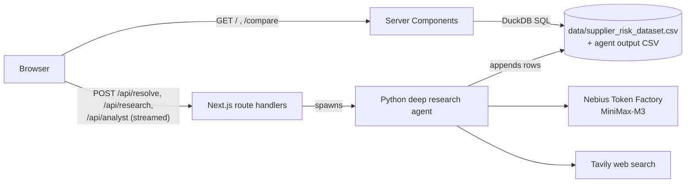

# Supplier risk intelligence

A Siemens Mobility hackathon project for procurement teams: a dashboard to
explore 10,000 anonymized suppliers and their risk profiles, plus a deep
research agent that investigates **real** companies on the public web and
scores them on the same risk schema.

- **Dashboard** (Next.js): filter, sort and chart the supplier portfolio, open
  a supplier profile, compare up to 20 suppliers side by side and export a
  shortlist memo.
- **Type-anywhere search and analyst chat**: start typing anywhere to search
  suppliers, or ask a question about the dataset in the chat dock.
- **Research a real company**: enter a company name; the agent checks for an
  existing match, resolves the official name, researches eight risk-criteria
  groups in parallel on the web with live progress, scores every risk
  dimension with a reason and source URLs, and adds the supplier to the
  dashboard.



Details: [docs/ARCHITECTURE.md](docs/ARCHITECTURE.md) (system design, data
flow, API reference, limitations) and [docs/TECH-STACK.md](docs/TECH-STACK.md)
(every framework, library, tool and external API used).

## Quick start with Docker

One image runs the dashboard and the agent; the API routes start the agent's
Python scripts inside the same container.

```bash
git clone https://github.com/Sy-D/suppler-risk-intelligence-siemens-hackathon.git
cd suppler-risk-intelligence-siemens-hackathon
cp .env.example .env          # fill in NEBIUS_API_KEY and TAVILY_API_KEY
docker compose up --build
```

Open http://localhost:3000. Research results persist in the `agent-output`
Docker volume.

## Local setup

### Prerequisites

| Tool | Version | Used for |
|---|---|---|
| [Node.js](https://nodejs.org) | 20.9 or newer | Runtime for Next.js 16 |
| [Bun](https://bun.sh) | 1.4 or newer | Package manager and script runner |
| [Python](https://www.python.org) | 3.12 or newer | Deep research agent |
| [Nebius Token Factory](https://tokenfactory.nebius.com) account | — | API key with access to `MiniMaxAI/MiniMax-M3` |
| [Tavily](https://tavily.com) account | — | Web search API key |
| [Docker](https://www.docker.com) | — | Only for the Docker quick start |

The dashboard works without API keys; only the agent features need them.

Node.js is required even though Bun runs the scripts: without `node` on the
`PATH`, Bun executes Next.js itself and the native DuckDB module fails to
load (`Failed to load external module @duckdb/node-api…`, HTTP 500 on `/`).

### Install

```bash
git clone https://github.com/Sy-D/suppler-risk-intelligence-siemens-hackathon.git
cd suppler-risk-intelligence-siemens-hackathon

# 1. Frontend dependencies
bun install

# 2. Agent: virtual environment at exactly this path — the API routes run
#    deep-research-agent/.venv/bin/python
python3 -m venv deep-research-agent/.venv
deep-research-agent/.venv/bin/pip install -r deep-research-agent/requirements.txt

# 3. Credentials in the repo root: fill in NEBIUS_API_KEY and TAVILY_API_KEY
cp .env.example .env
```

`.env` is gitignored and loaded by the agent scripts themselves; never commit
real keys. To use a different Python interpreter, set `ANALYST_PYTHON` to its
path before starting Next.js.

### Run

```bash
bun run dev
```

Open http://localhost:3000. A company research takes roughly 30–60 seconds.

The agent can also run on its own, without the dashboard:

```bash
cd deep-research-agent
.venv/bin/python app.py "Robert Bosch GmbH"          # score one supplier
.venv/bin/python app.py --jobs 2 "Bosch" "Siemens"   # several in parallel
.venv/bin/python analyst.py "Your risk question"     # sourced free-text answer
```

See [deep-research-agent/README.md](deep-research-agent/README.md) for the
agent's options.

## Using the dashboard

- **Search**: start typing anywhere (or press ⌘K / Ctrl+K) to open the search
  overlay. Arrow keys and Enter open a supplier profile; ⌘/Ctrl+Enter sends
  the text to the analyst chat instead.
- **Analyst chat**: answers two kinds of dataset questions — financial-risk
  comparisons (of the selected suppliers or of IDs named in the question) and
  risk profiles of named supplier IDs such as `SUPP_00012`. It computes the
  answers from the loaded data, without a model call.
- **Table and filters**: headers toggle sorting; filters cover risk level,
  maximum total and financial risk, minimum delivery rating and sourcing risk
  level.
- **Selection and chart**: select up to 20 rows to focus the chart and fact
  cards on them. Clicking a chart point opens the supplier profile in the
  right sidebar (a sheet on small screens).
- **Compare and export**: compare the selected suppliers on `/compare` or
  export a shortlist memo.
- **Research a real company**: the dialog first offers existing suppliers with
  a similar name, then shows the agent's progress and the sources behind
  each score. Researched companies appear with `RSCH_` ids next to the
  anonymized `SUPP_` dataset rows.

All risk scores run from 0 (no risk) to 100 (maximum risk); higher delivery
ratings are better. Column definitions are in
[data/risk_criteria_description.md](data/risk_criteria_description.md).

## Checks

```bash
bun run lint        # oxlint (incl. custom anti-slop rules) + ESLint
bun run typecheck   # tsc --noEmit
bun run build       # production build
```

## Repository layout

```
app/                    Next.js App Router
  page.tsx              Dashboard (rendered per request)
  compare/              Side-by-side comparison page
  api/resolve/          POST: casual name → official company name
  api/research/         POST: research + score a real company (SSE stream)
  api/analyst/          POST: sourced answer to a free-text question (SSE)
components/dashboard/   Dashboard UI (table, chart, filters, search, chat dock)
components/analyst/     Rendering of structured analyst answers
components/ui/          shadcn/ui components (Base UI primitives)
lib/supplier-data.ts    DuckDB query + zod validation of supplier rows
lib/agent-stream.ts     Runs agent scripts and streams progress as SSE
lib/agent-events.ts     Client-side reader for the agent streams
lib/fuzzy-match.ts      Finds existing suppliers for a typed company name
lib/analyst/            Answer schema and dataset-based answer composer
data/                   Anonymized supplier dataset and column descriptions
deep-research-agent/    Python agent (research, scoring, analyst Q&A);
                        pipeline details in OVERVIEW.md
Dockerfile, compose.yml All-in-one image (Next.js + Python agent)
design/mockups/         Static design snapshots
docs/                   Architecture and tech-stack documentation
tools/oxlint/           Custom lint rules
```
