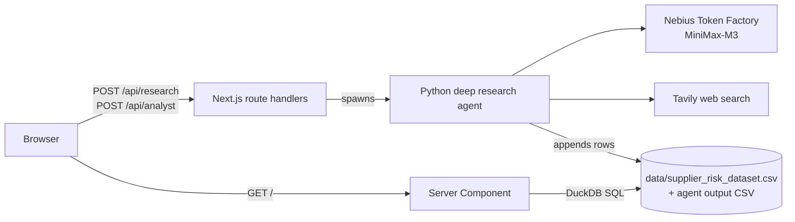

# Supplier risk intelligence

A Siemens Mobility hackathon project for procurement teams: a dashboard to
explore 10,000 anonymized suppliers and their risk profiles, plus a deep
research agent that investigates **real** companies on the public web and
scores them on the same risk schema.

- **Dashboard** (Next.js): filter, sort and chart the supplier portfolio, open
  a supplier profile, compare up to 20 suppliers and export a shortlist memo.
- **Research a real company**: enter a company name; the agent runs web
  research, scores every risk dimension with a reason and source URLs, and
  adds the supplier to the dashboard.
- **Ask your analyst**: free-text supplier-risk questions, answered with a
  sourced report.



Details: [docs/ARCHITECTURE.md](docs/ARCHITECTURE.md) (system design, data
flow, API reference, limitations) and [docs/TECH-STACK.md](docs/TECH-STACK.md)
(every framework, library, tool and external API used).

## Prerequisites

| Tool | Version | Used for |
|---|---|---|
| [Node.js](https://nodejs.org) | 20.9 or newer | Runtime for Next.js 16 |
| [Bun](https://bun.sh) | 1.4 or newer | Package manager and script runner |
| [Python](https://www.python.org) | 3.12 or newer | Deep research agent |
| [Nebius Token Factory](https://tokenfactory.nebius.com) account | — | API key with access to `MiniMaxAI/MiniMax-M3` |
| [Tavily](https://tavily.com) account | — | Web search API key |
| [Docker](https://www.docker.com) (optional) | — | Running the agent in a container |

The dashboard works without API keys; only the two agent features need them.

Node.js is required even though Bun runs the scripts: without `node` on the
`PATH`, Bun executes Next.js itself and the native DuckDB module fails to
load (`Failed to load external module @duckdb/node-api…`, HTTP 500 on `/`).

## Setup

```bash
git clone https://github.com/Sy-D/suppler-risk-intelligence-siemens-hackathon.git
cd suppler-risk-intelligence-siemens-hackathon

# 1. Frontend dependencies
bun install

# 2. Agent: virtual environment at exactly this path — the API routes run
#    deep-research-agent/.venv/bin/python
cd deep-research-agent
python3 -m venv .venv
.venv/bin/pip install -r requirements.txt

# 3. Credentials: fill in NEBIUS_API_KEY and TAVILY_API_KEY
cp .env.example .env
cd ..
```

`.env` is gitignored and loaded by the agent itself; never commit real keys.
To use a different Python interpreter, set `ANALYST_PYTHON` to its path
(relative to `deep-research-agent/` or absolute) before starting Next.js.

## Run

```bash
bun run dev
```

Open http://localhost:3000. A company research takes about one to two
minutes, an analyst answer usually under 30 seconds.

The agent can also run on its own, without the dashboard:

```bash
cd deep-research-agent
.venv/bin/python app.py "Robert Bosch GmbH"          # score one supplier
.venv/bin/python analyst.py "Your risk question"     # free-text answer
```

See [deep-research-agent/README.md](deep-research-agent/README.md) for the
agent's options and its Docker image.

## Using the dashboard

- Table headers toggle ascending/descending sorting; both searches offer
  keyboard-accessible supplier suggestions.
- Filters: risk level, maximum total and financial risk, minimum delivery
  rating, sourcing risk level.
- Select up to 20 table rows to focus the chart and fact cards on that
  selection. Clicking a chart point opens the supplier profile in the right
  sidebar (a sheet on small screens).
- Compare the selected risk profiles or export a shortlist memo.
- Researched companies appear with `RSCH_` ids next to the anonymized `SUPP_`
  dataset rows.

All risk scores run from 0 (no risk) to 100 (maximum risk); higher delivery
ratings are better. Column definitions are in
[data/risk_criteria_description.md](data/risk_criteria_description.md).

## Checks

```bash
bun run lint        # oxlint (incl. custom anti-slop rules) + ESLint
bun run typecheck   # tsc --noEmit
bun run build       # production build
```

## Repository layout

```
app/                    Next.js App Router: page and API route handlers
  api/research/         POST: research + score a real company
  api/analyst/          POST: answer a free-text risk question
components/dashboard/   Dashboard UI (table, chart, filters, detail, dialogs)
components/ui/          shadcn/ui components (Base UI primitives)
lib/supplier-data.ts    DuckDB query + zod validation of supplier rows
data/                   Anonymized supplier dataset and column descriptions
deep-research-agent/    Python agent (research, scoring, analyst Q&A, Docker)
design/mockups/         Static design snapshots
docs/                   Architecture and tech-stack documentation
tools/oxlint/           Custom lint rules
```
