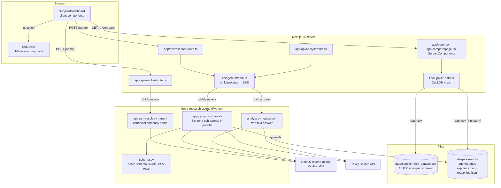

# Architecture

This document describes how the dashboard, the API routes and the Python deep
research agent fit together. For the agent's internal pipeline (criteria
sub-agents, prompts, failure handling) see
[deep-research-agent/OVERVIEW.md](../deep-research-agent/OVERVIEW.md); for its
CLI options see [deep-research-agent/README.md](../deep-research-agent/README.md).

## System overview



There is no separate backend service and no database server. Next.js serves
the UI and the API routes; the routes start the Python agent as a child
process per request, stream its progress to the browser and return its
stdout as the result. Supplier data lives in CSV files that
DuckDB queries in-process. The Docker image (`Dockerfile`, `compose.yml`)
packages Node.js and Python together for exactly this reason.

## Data flow

### Loading the dashboard

1. `app/page.tsx` is a Server Component and calls `getSuppliers()` from
   `lib/supplier-data.ts`. It is rendered per request
   (`dynamic = "force-dynamic"`), so newly researched rows show up on reload.
2. DuckDB (embedded, in-memory) runs one SQL query over
   `data/supplier_risk_dataset.csv`. If the agent has written
   `deep-research-agent/output/suppliers.csv`, those rows are added with
   `UNION ALL`, and their ids are remapped from `SUPP_` to `RSCH_` so they
   never collide with the anonymized dataset.
3. Every row is validated and mapped with a zod schema (scores are integers
   0–100, levels are `Low | Medium | High | Critical`). Invalid data fails
   loudly instead of rendering wrong numbers.
4. The validated list is passed to the client component `SupplierDashboard`,
   which does all filtering, sorting, charting and selection in the browser.
   `/compare?ids=…` loads the same data server-side and shows the selected
   suppliers side by side.

`@duckdb/node-api` is a native module, so it is listed in
`serverExternalPackages` in `next.config.ts` and loaded with Node's own
`require` instead of being bundled.

### Researching a real company

1. **Check the portfolio first.** The "Research a real company" dialog
   fuzzy-matches the typed name against the loaded suppliers
   (`lib/fuzzy-match.ts`: exact id, then character-bigram similarity ignoring
   legal suffixes such as GmbH or AG). If there are matches, the user can pick
   an existing supplier instead of researching it again.
2. **Resolve the name.** Otherwise the dialog calls `POST /api/resolve`, which
   runs `app.py --resolve <name>`: one short model call that turns casual
   input ("stadler") into the official company name ("Stadler Rail AG"). If
   the result differs, the user confirms it; on any failure the typed name is
   used.
3. **Research with live progress.** The dialog calls `POST /api/research`.
   `lib/agent-stream.ts` runs `app.py --json <name>` (5-minute timeout) and
   turns the agent's `PROGRESS|…` lines on stderr into Server-Sent Events, so
   the dialog shows an activity feed while the research runs.
4. **Score in parallel.** The agent splits the work into eight criteria groups
   (compliance and governance, financial and market, ESG and environmental,
   operations/quality/safety, labor, cyber, geopolitical and political,
   media and external intelligence). Each group is a small LangGraph ReAct
   agent with the Tavily search tool and the MiniMax-M3 model, and returns its
   scores with a reason and source URLs. Up to four groups run at once; a
   whole research takes roughly 30–60 seconds.
5. **Derive levels in code.** Levels and `Total_Risk_Index` are computed in
   `schema.py`, not by the model: a score below 25 is `Low`, below 50
   `Medium`, below 75 `High`, otherwise `Critical`; `Total_Risk_Index` is the
   mean of the 18 dimension scores.
6. **Persist.** The agent appends the row (with a `Last Modified` UTC
   timestamp) to `output/suppliers.csv` and the per-column reasoning to
   `output/suppliers_reasoning.jsonl`, then prints both as JSON.
7. **Show the result.** The route maps the row to the dashboard's supplier
   shape and sends it as the final `result` event. The dialog shows the
   scores and their sources; the dashboard adds the supplier to the table
   right away and selects it for comparison. After a reload it comes from the
   CSV as an `RSCH_` row.

### Asking the analyst

There are two analyst paths:

- **Chat dock (in the UI).** The type-anywhere search hands questions to the
  chat dock. `lib/analyst/compose.ts` answers them in the browser from the
  loaded supplier data. It handles two question types: financial-risk
  comparisons (ranking the selected suppliers or the `SUPP_` ids named in the
  question) and risk profiles of named supplier ids; anything else gets a
  hint with example questions. Answers follow the block schema in `lib/analyst/schema.ts` (text, tables, callouts) and are
  rendered by `components/analyst/`. No model or network call is involved.
- **`POST /api/analyst` (web research).** The route streams
  `analyst.py <question>`, which asks a `deepagents` Deep Agent for a sourced
  answer about any company or risk topic and returns it as Markdown. The
  route and its client (`AnalystSheet`) exist, but the dashboard currently
  does not render the sheet.

## API reference

All routes are Next.js Route Handlers that accept a JSON body. They need the
agent's virtual environment at `deep-research-agent/.venv` (or
`ANALYST_PYTHON` pointing to another interpreter, as in the Docker image) and
valid keys in `.env` at the repository root.

### Streaming format

`/api/research` and `/api/analyst` answer with `Content-Type:
text/event-stream`. Each event is one `data:` line with a JSON object:

```text
data: {"type":"progress","text":"Financial & market|started"}
data: {"type":"progress","text":"Financial & market|gathering information"}
…
data: {"type":"result","payload":{ … }}
```

| `type` | Fields | Meaning |
|---|---|---|
| `progress` | `text` (`"<step>\|<status>"`) | A progress step from the agent; any number of these |
| `result` | `payload` | Final result; route-specific, see below |
| `error` | `message` | The agent failed, timed out after 5 minutes or returned no usable result; a missing API key shows up as `agent exited with code 2` |

The stream ends after `result` or `error`. Because the status is only known
after the stream has started, agent errors arrive as `error` events with HTTP
status `200`. `lib/agent-events.ts` (`streamAgent`) is the client-side reader.

```bash
curl -N localhost:3000/api/research \
  -H 'Content-Type: application/json' \
  -d '{"name": "Stadler Rail AG"}'
```

### `POST /api/resolve`

Turns a casual company name into its official name.

Request `{"name": "stadler"}` (required, cut to 200 characters). Response
`200`: `{"canonical": "Stadler Rail AG"}`. If the resolver fails or takes
longer than 30 seconds, `canonical` is the input unchanged. `400`
`{"error": "Missing name"}` for an empty name.

### `POST /api/research`

Researches and scores one real company; streamed as described above.

Request:

```json
{ "name": "Stadler Rail AG" }
```

`name` is required, trimmed and cut to 200 characters; an empty name returns
`400` `{"error": "Missing supplier name"}` as plain JSON.

`payload` of the `result` event:

```json
{
  "supplier": {
    "id": "RSCH_00001",
    "name": "Stadler Rail AG",
    "risk": 42,
    "level": "Medium",
    "financial": 40,
    "quality": 60,
    "operational": 45,
    "compliance": 55,
    "esg": 25,
    "digital": 70,
    "governance": 50,
    "credit": 30,
    "delivery": 0,
    "exposure": 0,
    "sourcing": "Medium",
    "researched": true
  },
  "reasoning": {
    "supplierID": "SUPP_00001",
    "Supplier Name": "Stadler Rail AG",
    "columns": {
      "Financial_Health_Score": {
        "value": 40,
        "reason": "Short justification citing the findings …",
        "sources": ["https://…"]
      }
    }
  }
}
```

`reasoning.columns` contains one `{value, reason, sources}` entry for every
CSV column, including `Last Modified`. `delivery` and `exposure` are `0`
because delivery rating and purchase-order volume come from ERP data, not from
web research.

### `POST /api/analyst`

Answers a free-text supplier-risk question with web research; streamed as
described above.

Request `{"question": "What are the biggest current risk signals for
Continental AG?"}` (required, cut to 2,000 characters; empty returns `400`
`{"error": "Missing question"}`). `payload` of the `result` event:
`{"answer": "Markdown text with inline source links …"}`.

## Risk scores

The dataset and the agent use the same column schema; definitions are in
[data/risk_criteria_description.md](../data/risk_criteria_description.md).
All scores run from 0 (no risk) to 100 (maximum risk), also for dimensions
named "health", "stability" or "performance".

The anonymized dataset's `Total_Risk_Index` is a weighted average whose
weights were not provided. For researched companies it is the unweighted mean
of the 18 dimension scores, so the two are comparable in scale but not
derived identically.

## Configuration

| Variable | Where | Default | Purpose |
|---|---|---|---|
| `NEBIUS_API_KEY` | `.env` (repo root) | — (required) | Token Factory API key |
| `TAVILY_API_KEY` | `.env` (repo root) | — (required) | Tavily API key |
| `NEBIUS_MODEL` | `.env` (repo root) | `MiniMaxAI/MiniMax-M3` | Model id |
| `NEBIUS_BASE_URL` | `.env` (repo root) | `https://api.tokenfactory.nebius.com/v1` | Token Factory endpoint |
| `ANALYST_PYTHON` | Next.js environment | `.venv/bin/python` | Interpreter the API routes run, relative to `deep-research-agent/`; the Docker image sets `/usr/local/bin/python3` |

## Design decisions

- **Child process instead of an agent service.** The routes spawn the Python
  agent directly. That keeps the setup to one `bun run dev` (or one
  container) with no second server to start, at the cost of a Python start-up
  per request. Progress is streamed from the child process's stderr, so the
  user still sees what the agent is doing.
- **One focused sub-agent per criteria group.** Splitting research and
  scoring into eight parallel groups cut a research from about 75–90 seconds
  (one Deep Agent plus one large extraction call) to roughly 30 seconds, and
  a failing group falls back to documented middle-range defaults instead of
  failing the whole supplier.
- **Dataset questions answered without a model.** The chat dock computes its
  answers from the loaded data, so they are instant, deterministic and work
  offline; web research is reserved for real companies.
- **CSV + DuckDB instead of a database.** The dataset ships as CSV; DuckDB
  queries it in-process with SQL, and researched rows are just another CSV
  in the same query.
- **Scores from the model, levels from code.** The model only produces
  scores, reasons and sources; level thresholds and the total index are
  deterministic, so all rows are scored consistently and every number is
  traceable to its sources in `suppliers_reasoning.jsonl`.

## Limitations

- Agent scores are model estimates based on public web sources. They are a
  starting point for due diligence, not a verified rating; check the cited
  sources before acting on them.
- Research runs inside the HTTP request (5-minute timeout); there is no job
  queue, and closing the dialog does not cancel the agent process.
- Researched rows are stored in a local CSV file (in Docker: the
  `agent-output` volume), so they exist only where the research ran.
- ERP columns (purchase-order volume, delivery rating, order change and
  confirmation rate) stay empty for researched companies.
- The chat dock understands only the two question types above; open-ended
  questions need `POST /api/analyst`, which the dashboard does not show yet.
- `Last Modified` was added to the agent's CSV schema; an
  `output/suppliers.csv` written by an older version has one column fewer
  and should be deleted.
