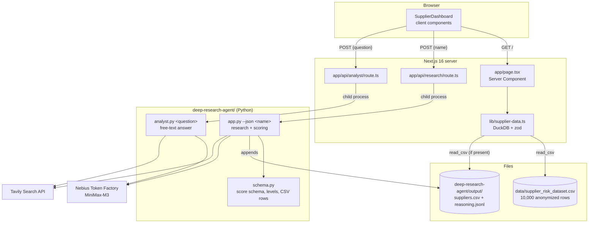

# Architecture

This document describes how the dashboard, the API routes and the Python deep
research agent fit together. For the agent's internal pipeline (prompts,
scoring schema, CLI options) see
[deep-research-agent/README.md](../deep-research-agent/README.md).

## System overview



There is no separate backend service and no database server. Next.js serves
the UI and the API routes; the routes start the Python agent as a child
process per request and read its stdout. Supplier data lives in CSV files that
DuckDB queries in-process.

## Data flow

### Loading the dashboard

1. `app/page.tsx` is a Server Component and calls `getSuppliers()` from
   `lib/supplier-data.ts`.
2. DuckDB (embedded, in-memory) runs one SQL query over
   `data/supplier_risk_dataset.csv`. If the agent has written
   `deep-research-agent/output/suppliers.csv`, those rows are added with
   `UNION ALL`, and their ids are remapped from `SUPP_` to `RSCH_` so they
   never collide with the anonymized dataset.
3. Every row is validated and mapped with a zod schema (scores are integers
   0–100, levels are `Low | Medium | High | Critical`). Invalid data fails
   loudly instead of rendering wrong numbers.
4. The validated list is passed to the client component `SupplierDashboard`,
   which does all filtering, sorting, charting and comparison in the browser.

`@duckdb/node-api` is a native module, so it is listed in
`serverExternalPackages` in `next.config.ts` and loaded with Node's own
`require` instead of being bundled.

### Researching a real company

1. The "Research a real company" dialog sends `POST /api/research` with the
   company name.
2. The route runs `deep-research-agent/.venv/bin/python app.py --json <name>`
   (5-minute timeout).
3. The agent researches the company with Tavily web search, scores all 18 risk
   dimensions plus sourcing risk and supply-chain complexity with the
   MiniMax-M3 model, and returns each score with a reason and source URLs.
4. Levels and `Total_Risk_Index` are derived in code (`schema.py`), not by the
   model: a score below 25 is `Low`, below 50 `Medium`, below 75 `High`,
   otherwise `Critical`; `Total_Risk_Index` is the mean of the 18 dimension
   scores.
5. The agent appends the row to `output/suppliers.csv` and the per-column
   reasoning to `output/suppliers_reasoning.jsonl`, then prints both as JSON.
6. The route maps the row to the dashboard's supplier shape and returns it.
   The dashboard adds the supplier to the table right away and selects it for
   comparison; after a reload it comes from the CSV as an `RSCH_` row.

### Asking the analyst

The "Ask your analyst" sheet sends `POST /api/analyst`; the route runs
`analyst.py <question>`, which asks the same deep agent for a sourced answer
and prints it as Markdown.

## API reference

Both routes are Next.js Route Handlers, accept JSON and return JSON. They need
the agent's virtual environment at `deep-research-agent/.venv` (or
`ANALYST_PYTHON` pointing to another interpreter) and valid keys in
`deep-research-agent/.env`.

### `POST /api/research`

Researches and scores one real company.

Request:

```json
{ "name": "Continental AG" }
```

`name` is required, trimmed and cut to 200 characters.

Response `200`:

```json
{
  "supplier": {
    "id": "RSCH_00001",
    "name": "Continental AG",
    "risk": 42,
    "level": "Medium",
    "financial": 40,
    "quality": 60,
    "operational": 45,
    "compliance": 55,
    "esg": 25,
    "digital": 70,
    "governance": 50,
    "credit": 30,
    "delivery": 0,
    "exposure": 0,
    "sourcing": "Medium",
    "researched": true
  },
  "reasoning": {
    "supplierID": "SUPP_00001",
    "Supplier Name": "Continental AG",
    "columns": {
      "Financial_Health_Score": {
        "value": 40,
        "reason": "Short justification citing the findings …",
        "sources": ["https://…"]
      }
    }
  }
}
```

`reasoning.columns` contains one `{value, reason, sources}` entry for every
CSV column. `delivery` and `exposure` are `0` because delivery rating and
purchase-order volume come from ERP data, not from web research.

Errors:

| Status | Body | Cause |
|---|---|---|
| `400` | `{"error": "Missing supplier name"}` | Empty or missing `name` |
| `502` | `{"error": "<message>"}` | Agent failed, timed out after 5 minutes, or returned no row; a missing API key shows up here as `NEBIUS_API_KEY is not set …` |

### `POST /api/analyst`

Answers a free-text supplier-risk question with web research.

Request:

```json
{ "question": "What are the biggest current risk signals for Continental AG?" }
```

`question` is required, trimmed and cut to 2,000 characters.

Response `200`:

```json
{ "answer": "Markdown text with inline source links …" }
```

Errors: `400` `{"error": "Missing question"}`, `502` `{"error": "<message>"}`
as above.

## Risk scores

The dataset and the agent use the same column schema; definitions are in
[data/risk_criteria_description.md](../data/risk_criteria_description.md).
All scores run from 0 (no risk) to 100 (maximum risk), also for dimensions
named "health", "stability" or "performance".

The anonymized dataset's `Total_Risk_Index` is a weighted average whose
weights were not provided. For researched companies it is the unweighted mean
of the 18 dimension scores, so the two are comparable in scale but not
derived identically.

## Configuration

| Variable | Where | Default | Purpose |
|---|---|---|---|
| `NEBIUS_API_KEY` | `deep-research-agent/.env` | — (required) | Token Factory API key |
| `TAVILY_API_KEY` | `deep-research-agent/.env` | — (required) | Tavily API key |
| `NEBIUS_MODEL` | `deep-research-agent/.env` | `MiniMaxAI/MiniMax-M3` | Model id |
| `NEBIUS_BASE_URL` | `deep-research-agent/.env` | `https://api.tokenfactory.nebius.com/v1` | Token Factory endpoint |
| `ANALYST_PYTHON` | Next.js environment | `.venv/bin/python` | Interpreter the API routes run, relative to `deep-research-agent/` |

## Design decisions

- **Child process instead of an agent service.** The routes spawn the Python
  agent directly. That keeps the hackathon setup to one `bun run dev` with no
  second server to start, at the cost of a Python start-up per request.
- **CSV + DuckDB instead of a database.** The dataset ships as CSV; DuckDB
  queries it in-process with SQL, and researched rows are just another CSV
  in the same query.
- **Scores from the model, levels from code.** The model only produces
  scores, reasons and sources; level thresholds and the total index are
  deterministic, so all rows are scored consistently and every number is
  traceable to its sources in `suppliers_reasoning.jsonl`.

## Limitations

- Agent scores are model estimates based on public web sources. They are a
  starting point for due diligence, not a verified rating; check the cited
  sources before acting on them.
- Research runs synchronously inside the HTTP request (one to two minutes,
  5-minute timeout); there is no job queue or progress streaming.
- Researched rows are stored in a local CSV file, so they exist only on the
  machine that ran the research.
- ERP columns (purchase-order volume, delivery rating, order change and
  confirmation rate) stay empty for researched companies.
- In a production build (`bun run build`) the page `/` is currently
  prerendered at build time, so researched rows only show up after a reload
  in `bun run dev`. Run the demo with `bun run dev`.
